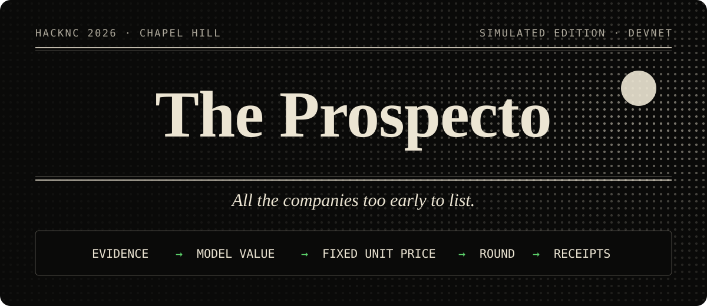
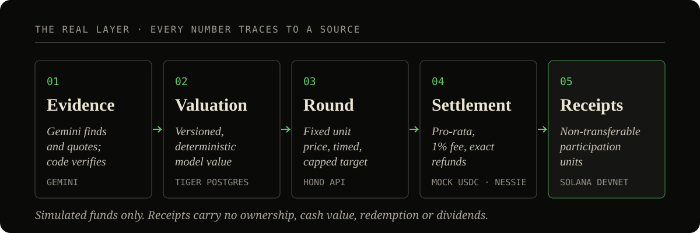

<p align="center">
  
</p>

<p align="center">
  <b>The only platform where you can back your friend's startup.</b><br>
  <sub>Built at <b>HackNC 2026</b> · a simulation on Solana Devnet with mock money and no real securities</sub>
</p>

<p align="center">
  
  
  
  
  
  
  
</p>

---

## The problem

Campus startups are too early for VCs and too informal for crowdfunding portals. The people who believe in them first, their classmates, have no structured way to back them. And when a founder names a price, nobody can see where it came from.

## What Prospecto does

A founder pastes links: a website, a GitHub repo, a short pitch. Prospecto researches the evidence, computes a **transparent model value**, and opens a **fixed-price primary round** that other students can join with simulated funds. Every number on the page answers one question: ***"Why is this the price?"***

- **Evidence over pedigree.** Gemini finds and quotes sources; deterministic code verifies the quotes and decides what each claim is worth. Missing evidence starts at a neutral 0.50, never at zero, and is never invented.
- **An auditable price.** Stage-weighted factor scores, scenario values and a versioned model (`valuation-v0.1`) produce one unit price, stored with all of its inputs.
- **Fair rounds.** Commitments are pro-rata, not first-come-first-served. A disclosed 1% fee applies only to accepted amounts, and oversubscription is refunded exactly.
- **Honest receipts.** Participants receive non-transferable participation units, not shares, with no secondary trading.

<p align="center">
  
</p>

## Demo walkthrough

| Step | Page | What to look at |
| --- | --- | --- |
| 1 | `/` | The front page. Move your cursor over the halftone hero to move the sun |
| 2 | `/launch/` | The founder interview: paste links, watch evidence research run, preview the valuation, publish |
| 3 | `/desk/` | The Estimate Desk: how each factor and the stage weights move the model value |
| 4 | `/rounds/` | Every open round, with its exact unit price and percent committed |
| 5 | `/round/?slug=…` | One round's terminal: model value, fixed unit price, commitment gauge, countdown |
| 6 | `/project/?slug=…` | The company profile: claims, sources and verification status |
| 7 | `/participate/` | Real participation: sign in, prove a Phantom wallet, fund it from a Nessie mock account, sign a subscription, track allocation |

## Built with

| Sponsor tech | Role in Prospecto | Status |
| --- | --- | --- |
| **Gemini** (3.1 Flash-Lite, Search grounding, URL context) | Researches founder links and extracts cited claims. Advisory only: it never sets a score or a price | ✅ Live |
| **Tiger Data** (Tiger Cloud Postgres) | Projects, evidence, versioned valuation snapshots and rounds; forward-only migrations via `dbmate` | ✅ Live |
| **Solana** (Devnet) | Anchor program for funding, subscriptions, pro-rata allocation, refunds and withdrawals; non-transferable Token-2022 receipts; wallet binding by ed25519 signature | 🟡 Built and tested, Devnet deploy pending |
| **Capital One Nessie** | Server-side adapter: mock bank balances fund demo wallets with mock USDC through a recoverable saga that never retries a bank write blindly | 🟡 Built, off until sandbox-verified |

| Layer | Choice |
| --- | --- |
| Frontend | Next.js 15 (App Router, static export), React 19, strict TypeScript, hand-written CSS, GSAP, a WebGL halftone shader |
| Backend | Hono on Node 24, Zod at every boundary, parameterized SQL via `pg` (no ORM), Better Auth with campus-email OTP |
| Money | Integer micro-USD end to end (`BigInt` in TS, `NUMERIC` in SQL); the UI formats prices but never computes them |
| Hosting | One Vercel project with two services, the static site and the API as Vercel Functions, with `/api/*` rewritten to the API |

## Built with AI tools

<p>
  
  
</p>

We built Prospecto with two AI coding agents, **Claude Code** (Anthropic) and **Codex** (OpenAI), working in the same repository. Both read one shared rulebook, [`AGENTS.md`](AGENTS.md), which sets out what they may and may not do:

- financial formulas follow the docs exactly, and money is integer micro-USD, never floating point;
- every change gets type, lint and test checks before it counts as done;
- commits use the `<type>(<scope>): <description>` format;
- product copy never calls receipts equity or shares.

AI also runs inside the product: **Gemini** researches founder evidence. The two roles stay separate. The coding agents built the software, and inside it Gemini's output is advisory only, so deterministic code sets every score and price.

## Under the hood

```text
model_reference_value = α_stage × current_operating_value + (1 − α_stage) × scenario_value
unit_price_micro_usd  = floor(round_implied_value × 1,000,000 / REFERENCE_UNITS)    # REFERENCE_UNITS = 1,000,000
protocol_fee          = floor(accepted × 100 / 10,000)                               # 1%, on accepted amounts only
```

A $100 accepted commitment at $1 per unit yields **99 units** after the fee. That example, along with oversubscription, dust and zero-unit cases, lives in the [golden fixtures](docs/fixtures/nessie-purchase-cases.json) that the tests check against.

<details>
<summary><b>API surface</b></summary>

| Method | Path | Purpose |
| --- | --- | --- |
| `GET` | `/api/projects`, `/api/projects/:slugOrId` | Published profiles with their latest valuation |
| `POST` | `/api/projects` · `/:id/publish` | Create and publish a founder profile |
| `POST` | `/api/projects/:id/research-runs` | Start a Gemini evidence-research run (rate-limited, cached 24 h) |
| `POST` | `/api/projects/:id/valuation/preview` | Deterministic valuation preview |
| `POST` | `/api/projects/:id/rounds` | Open a fixed-price round |
| `GET` | `/api/rounds/:id` · `/:id/quote` | Round state and an exact commitment quote |
| `POST` | `/api/wallets/challenge` · `/verify` | Bind a Solana wallet by signature |
| `POST` | `/api/demo/sign-in` | Campus-email demo sign-in (only when `DEMO_MODE=true`) |

</details>

## Run it locally

```bash
# 1. Configure (never commit real values)
cp .env.example .env.local        # DATABASE_URL, BETTER_AUTH_SECRET, GEMINI_API_KEY, …

# 2. API on :8787
cd backend && npm ci
npm run db:migrate                # Tiger Postgres schema + valuation-v0.1
npm run db:seed                   # demo companies (idempotent; --dry-run previews prices)
npm run dev

# 3. Web on :3000 (proxies /api/* to :8787)
cd ../web && npm install && npm run dev
```

Checks: `npm test` and `npm run typecheck` in `backend/`; `npm run lint` and `npm run build` in `web/`; `cargo test --manifest-path chain/Cargo.toml` for the program. Enabling real purchases (program deploy, mock-USDC mint, Nessie fixtures) is a separate operator checklist in [PURCHASE_SETUP](docs/PURCHASE_SETUP.md).

## Repository map

```text
web/        Next.js front end (landing, launch, desk, rounds, round, project, news)
backend/    Hono API: auth, evidence research, valuation, rounds, settlement math, wallets
chain/      Anchor program: rounds, subscriptions, allocation, refunds, Token-2022 receipts
db/         Forward-only SQL migrations and the versioned valuation-model seed
docs/       Architecture, valuation, evidence research, purchase flow, legal posture
```

## Honest status

- **Real:** evidence research, valuation, profiles, rounds and wallet binding run against the live database. The backend suite has 212 passing tests.
- **Seeded:** `db:seed` opens the demo companies' rounds and writes their committed totals directly. They fill the board; they are not real subscriptions.
- **Built, not yet live:** the Anchor program, Token-2022 receipts and the Nessie funding saga are implemented and pass their tests, including the documented golden cases and non-transferability. They wait on operator setup: Devnet deploy, mock-USDC mint, a verified Nessie sandbox. Until then purchases stay disabled and `/participate/` shows a setup notice.
- **Planned for the demo:** a clearly labeled *simulated session*, a seeded bonding-curve market in play credits that reads the real price but never writes to it ([DEMO_UI_PLAN](docs/DEMO_UI_PLAN.md)).

> [!IMPORTANT]
> Prospecto is a **simulation**. Balances and tokens are mock assets on Devnet. Participation receipts carry no ownership, cash value, redemption, dividends or conversion to equity. Nessie is a mock banking API, not a bank connection or an identity check. The valuation model is illustrative, not an appraisal or investment advice. See [LEGAL_POSTURE](docs/LEGAL_POSTURE.md) for the regulated route a real version would need.

## Docs

[Market architecture](docs/MARKET%20ARCHITECTURE.md) · [Backend stack](docs/BACKEND_STACK.md) · [Evidence research](docs/EVIDENCE_RESEARCH.md) · [Nessie purchase flow](docs/NESSIE_PURCHASE_FLOW.md) · [Demo UI plan](docs/DEMO_UI_PLAN.md) · [Purchase setup](docs/PURCHASE_SETUP.md) · [Legal posture](docs/LEGAL_POSTURE.md) · [Original mega plan](docs/MEGA_PLAN.md)

---

<p align="center"><sub>Made at HackNC 2026 · <a href="LICENSE">MIT</a> · <a href="https://github.com/ezrazhang7/hack-nc-2026">ezrazhang7/hack-nc-2026</a></sub></p>
