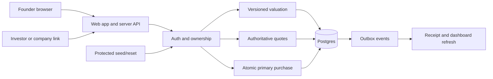

# HackNC 2026 — Direct Startup Share Investing: Mega Plan

Repository: [ezrazhang7/hack-nc-2027](https://github.com/ezrazhang7/hack-nc-2027)  
Updated: October 10, 2026  
Status: proposed product/build specification; no application or runtime verification implemented yet.  
Working name: **FirstStake**, subject to the team's choice.

> **Current implementation source:** [MARKET ARCHITECTURE.md](MARKET%20ARCHITECTURE.md), [BACKEND_STACK.md](BACKEND_STACK.md), and the complete [Nessie purchase flow](NESSIE_PURCHASE_FLOW.md) define the active Solana Devnet/Tiger/Nessie design. The earlier database-credit purchase and option proposals below are historical; do not implement those backend sections. Nessie funds wallets, Solana settles primary participation receipts, and Tiger records recovery and dashboards.

Business rationale: see [users](#28-first-users-and-potential-customers), [benefits](#29-why-the-product-is-useful), [competitors](#30-competitive-landscape), [differentiation](#31-where-we-could-be-better-and-how-to-demonstrate-it), [demand](#32-demand-evidence-and-its-limits), [VC-and-small-investment-questions](#33-why-complement-vcs-and-why-small-investments-matter), and [validation](#34-validation-positioning-and-execution).

## 1. Product direction

Build a platform where people discover startups at any stage and **buy shares directly from the startup** through a simple investment page. A founder can add an **“Invest in us”** link to their website, share their company profile, and raise funding through structured checkout.

Discovery welcomes idea-stage projects, unincorporated teams, prototypes, launched startups, and growing private companies. Company stage and legal entity status are recorded separately; an early project need not pretend to be an incorporated company to create a profile.

**HackNC MVP:** every registered demo user can buy platform-issued simulated startup shares with free, non-redeemable demo credits. Each purchase creates a virtual share holding and credits the startup's simulated funding account immediately. This demonstrates the full investment flow without claiming that a database entry creates legal equity.

**Long-term direction:** actual share issuance for suitable participating issuers through a validated legal and settlement arrangement. Actual and virtual shares use distinct instrument types and balances. Virtual holdings do not automatically convert into actual equity.

**Current scope: startup-to-investor purchases only.** No investor resale, order book, secondary trading, guaranteed cash-out, or premium/exercise/expiry option mechanism.

The demo story: **founder profile → initial valuation suggestion → fixed-price offering → website investment link → virtual share purchase → investor holding and startup funding update together.**

## 2. Meaning of shares and the Freeport reference

| Instrument | Payment | Buyer receives | MVP |
| --- | --- | --- | --- |
| SIMULATED_SHARE | Free demo credits | Recorded virtual allocation; no equity, cash value, redemption, or dividends | Enabled |
| ACTUAL_EQUITY | Real funds through an approved arrangement | Defined ownership after valid issuance and confirmed settlement | Disabled; future integration |
| Synthetic exposure | Real money linked to company value | A separate financial contract that may convey no ownership | Outside scope |

For an unincorporated team, display **“Unincorporated project · simulated shares.”** Do not invent a corporate share class or claim the platform owns that project. The accessibility vision covers all stages; actual participation depends on issuer, instrument, investor, and jurisdiction requirements. Digital formatting alone does not remove securities obligations. [SEC staff statement](https://www.sec.gov/newsroom/speeches-statements/corp-fin-statement-tokenized-securities-012826-statement-tokenized-securities)

Freeport Markets inspires broad discovery, company-related market information, and portfolio presentation. Its own explanation distinguishes pre-IPO perpetual exposure from company shares and describes separate SPV-backed instruments. Its live trading model is not a play-money simulation or this primary fundraising flow. Borrow the browsing experience; do not copy leverage, derivatives, or continuous trading. [Freeport explanation](https://freeportmarkets.com/)

An early startup generally lacks an observable continuously traded share price. Our estimate is a transparent model anchor; our offering price is a founder-approved term. Neither is an identical replica of a real market.

## 3. Assumptions and operating rules

| Decision | MVP rule |
| --- | --- |
| Users | Every registered demo user can participate |
| Stages | IDEA, PROTOTYPE, LAUNCHED, REVENUE, GROWTH |
| Entity status | Unincorporated project or incorporated entity; independent of stage |
| Money | Free DEMO_USD credits; no purchased credits or withdrawals |
| Purchase | Newly issued units directly from startup |
| Quantity | Positive whole shares; fractional units deferred |
| Initial price | Algorithm proposes; founder accepts or overrides with reason |
| Round pricing | Fixed once published; valuation updates do not silently reprice it |
| Capacity | Finite approved new-share issuance cap |
| Fees | Zero in MVP; explicit fee field in quotes |
| Settlement | Immediate atomic credit transfer and issuance |
| Social | Founder bios, website/LinkedIn links, optional public contact; follows/updates after core flow |
| Future rights | Optional later extension; not necessary to invest now |

Assume three or four teammates and a relative 24-hour build. Adjust to the actual time remaining and organizers' submission instructions. HackNC describes a 24-hour project challenge and recommends teams of three or four. [HackNC](https://hacknc.com/)

## 4. Users, value, and validation

Initial audience recommendation: campus founders and their existing communities, with entrepreneurship clubs/incubators as potential organizers and customers. This is a segment hypothesis, not validated adoption. The detailed distinction between simulation users and future actual-investment users is in section 28.

**Founder:** “I want to explain my company and share one link where backers can buy an allocation.” Provide profile, suggested initial valuation, offering creation, proceeds tracking, and allocation records.

**Investor:** “I want to understand the startup, founders, price, and rights before buying.” Provide clear terms, costs, immediate receipt, holdings, and company updates.

**Judge:** demonstrate an approachable product supported by reproducible valuation logic and a backend that conserves credits/shares under competing requests and retries.

Ask founders/backers: Is a website link easier than a marketplace? What company information matters? Can they distinguish virtual units from actual ownership? Can a founder explain the estimate and its uncertainty? Can the investor identify price, units, proceeds, and lack of liquidity? Would defined future-round participation matter?

Record qualitative feedback without claiming adoption or product-market fit. A useful clarity gate is four of five test users correctly explaining the share type and payment destination.

## 5. Founder and investor journeys

### Founder

1. Create company draft; enter stage/entity status, story, sector, website, LinkedIn links, founder bios, and contact preferences.
2. Supply product/traction/financial inputs with dates and evidence labels.
3. Request a valuation estimate and inspect assumptions, sensitivity range, and evidence quality.
4. Accept a simulation anchor or override it with an explanation.
5. Set pre-round virtual founder supply, finite new-share cap, price, purchase limits, and round deadline.
6. Preview allocation/dilution at full subscription and publish immutable offering terms.
7. Copy the hosted investment URL or ordinary link snippet into the company website.
8. View completed proceeds, issued shares, and remaining capacity; optionally publish updates.

### Investor

1. Follow the company's investment link or browse by stage/sector.
2. Read company information, founder links, entity status, instrument label, and offering terms.
3. Sign in; receive a single free demo-credit grant.
4. Enter quantity and obtain a server-generated quote showing unit price and total.
5. Confirm simulation terms; purchase.
6. Receive a persistent receipt and virtual holding; refresh to verify persistence.
7. Follow company updates if the social feature is ready.

## 6. MVP scope and priority

**P0:** landing/discovery; founder profile with website/LinkedIn/contact/privacy fields; deterministic initial valuation; accepted fixed-price offering; shareable investment link; authenticated credit grant; authoritative quote; atomic purchase; holdings/receipt; founder proceeds dashboard; protected reset/reconciliation; hosted demonstration and critical verification.

The minimum social profile is founder identity/bio and public links. It is part of P0. Richer social actions are optional until the purchase path is stable.

**P1:** follow/unfollow, founder update feed/publishing, saved companies, better valuation explanation, consent-based public contact button.

**P2:** reviewed website prefill, AI explanation grounded in saved inputs, early-backer indicator/future-right data model, receipt export, reconciliation UI.

**Outside MVP:** resale, buybacks, real custody/payments/equity settlement, options, derivatives, leverage, dividends, automatic repricing, private chat, full social network, and guaranteed conversion of virtual units.

If time slips, cut P1/P2 before transaction correctness. A flow that changes a browser balance but never persists issuance should be presented as a concept walkthrough, not completed settlement.

## 7. Company information and social design

| Group | Inputs | Visibility |
| --- | --- | --- |
| Identity | Name, slug, stage, sector, location, entity status | Public when published |
| Story | Problem, solution, product status, business model | Founder-approved public fields |
| Web presence | Website, product/demo URL | Public links |
| Founders | Name, role, bio, LinkedIn URL, optional photo | Public with consent |
| Contact | Account email; separate optional public contact email/URL | Account email private by default |
| Traction | Users/customers, pilots, dated revenue/growth | Explicit public/private choices |
| Financial inputs | Revenue, cash, burn, funding history, disclosed debt | Private unless explicitly published |
| Evidence | Source/date and self-reported/imported/checked status | Appropriate public summary |
| Community | Follows and founder updates | Public; excluded from valuation |

P0 accepts website and LinkedIn **URLs** without requiring scraping or API connections. A submitted LinkedIn link is not identity verification. A website does not verify revenue, ownership, or the truth of company claims. Followers are not investors, and popularity is not company value.

If prefill is added, a founder reviews extracted facts before publication. Restrict URL fetching to approved public destinations; block private/local addresses, revalidate redirects/DNS, bound response size/time, and treat page content as untrusted data. Never fetch user URLs with internal credentials. Defer automated LinkedIn ingestion; founders provide their information directly.

Avoid public exposure of private financial inputs through valuation explanations. Use respectful, non-sensitive scoring inputs rather than personal demographics.

## 8. Screens and link-to-invest UX

| Route | Content/action |
| --- | --- |
| `/` | Pitch, simulation explanation, explore/create company |
| `/explore` | Search, stage/sector filters, company cards |
| `/companies/[slug]` | Story, founders/links, stage, entity status, valuation summary, offering |
| `/invest/[offeringId]` | Share type, fixed price, available capacity, deadline, quantity |
| `/checkout/[quoteId]` | Exact quote, demo balance, confirmation |
| `/portfolio` | Credit balance, quantities, historical cost basis, receipts |
| `/orders/[id]` | Quantity, price, total, terms snapshot, settlement time |
| `/founder` | Own company list, proceeds, issued/remaining units |
| `/founder/company/[id]` | Profile/privacy inputs and valuation request |
| `/founder/offerings/new` | Accepted value, supply, cap, price, publish preview |
| `/demo` | Protected scenario reset and integrity check |

Use an ordinary website anchor to the investment URL, not a script requiring privileged credentials. Design calm readable numbers, explicit instrument labels, keyboard-accessible forms, text status badges, and clear empty/loading/error states. Show **Simulation — demo credits and virtual shares** during checkout and in the portfolio. No cash-out button.

## 9. Initial valuation algorithm: purpose and inputs

Propose an initial **illustrative pre-money equity valuation** that founders can use to set a virtual issue price. The hackathon algorithm is a reproducible heuristic, not an appraisal, investment recommendation, or assurance of fair value. A website alone rarely supports a reliable startup assessment.

For an unincorporated project, the output is a hypothetical simulation anchor, not a corporate equity appraisal. Never infer authorized shares or a verified cap table from a website.

Collect stage, product progress, stage-appropriate traction, team relevance/time commitment, dated financial readiness, and evidence provenance. Record missing data as unknown, not invented revenue. Financial inconsistencies, missing data, and disclosed debt reduce evidence quality; v1 does not implement enterprise-value-to-equity-value or a debt waterfall.

The founder sees input sources, model version, category contributions, sensitivity range, and quality notes before accepting a price. Founder overrides retain the original estimate and a reason. A claimed higher value does not create credits, shares, or verification.

## 10. Valuation v1 formula and versioning

These anchors are **invented demo constants**, not market benchmarks or prices for real investments:

| Stage | Demo anchor |
| --- | --- |
| IDEA | $100,000 |
| PROTOTYPE | $500,000 |
| LAUNCHED | $1,000,000 |
| REVENUE | $2,000,000 |
| GROWTH | $5,000,000 |

Score each category from 0–100 using a saved ordinal rubric (0/25/50/75/100) and stage-specific questionnaire:

| Category | Weight | Basis |
| --- | --- | --- |
| Product | 30% | Demonstrable progress relative to declared stage |
| Traction | 30% | Documented interviews/pilots for early teams; usage/customers/retention for launched teams |
| Team | 25% | Relevant building/delivery experience and commitment; no protected demographic inputs |
| Financial readiness | 15% | Consistent dated runway/business-model inputs |

A first implementation rubric can use the following anchors; retain the underlying responses and evidence rather than only a numeric total:

| Score | Product progress | Traction validation | Team readiness | Financial readiness |
| --- | --- | --- | --- | --- |
| 0 | No milestone evidence | No validation evidence | No relevant information | No usable financial/business inputs |
| 25 | Milestone described | Informal conversations | Roles/availability described | Business model described |
| 50 | Working stage-appropriate demonstration | Documented interviews/pilot/usage | Relevant experience and named responsibilities | Consistent revenue/burn/cash or pre-revenue assumptions supplied |
| 75 | Demonstration tested with intended users | Repeat use or committed pilots/customers | Evidence of prior relevant delivery | Dated budget and calculable runway when meaningful |
| 100 | Repeated milestone delivery with evidence | Multiple corroborated stage-appropriate validation sources | Complementary delivery experience and committed coverage | Consistent documented inputs and explicit uncertainty/scenarios |

These ordinal anchors are qualitative demo rules, not a scientific measure of company quality. A founder claim alone cannot become independently checked evidence. Save the question answers, rubric version, and provenance so the output is explainable.

Missing responses contribute zero under this explicitly conservative toy convention and reduce evidence coverage. Explain that unknown is not proof of poor performance. Invalid/out-of-range scores are rejected.

```text
score = 0.30*product + 0.30*traction + 0.25*team + 0.15*financial
multiplier = 0.50 + score/100
suggested_pre_money = stage_anchor * multiplier
sensitivity_low = suggested_pre_money * 0.60
sensitivity_high = suggested_pre_money * 1.50
```

The sensitivity bounds are arbitrary scenario bands, not statistical confidence intervals. A launched fictional startup scoring 50 in all categories produces score 50, multiplier 1, estimate $1M, and $600k–$1.5M band.

Save `valuation-model-v1`, rubric/anchor versions, inputs, evidence timestamps, scores, rounding, and output. Show input coverage and self-reported/checked counts separately as LOW/MEDIUM/HIGH **evidence quality**, not a success probability. Suppress numeric estimates when required core inputs/stage are absent; permit a clearly labeled manual simulation anchor.

Recompute only from a new submitted input version. A new valuation is informational and never rewrites existing purchases or changes published round prices. AI may propose extracted facts or explain the deterministic output, but cannot fabricate verification, choose binding prices, or authorize investments.

Later, replace toy constants with reviewed comparable data and calibrated methods; test errors and bias before offering real pricing assistance. Follow counts/contact information are excluded.

## 11. Valuation to price, share supply, and allocation

Choose a virtual pre-round founder supply `S0`. This is a simulation denominator. Actual issuance would require a verified fully diluted cap table, authorized issuance, and defined share-class rights.

```text
raw_price = accepted_pre_money_value / S0
unit_price_cents = round_nearest_cent(raw_price * 100)
implied_pre_money = unit_price_cents * S0 / 100
cost_cents = quantity * unit_price_cents
issued_supply = S0 + cumulative_primary_units_sold
holder_allocation = holder_quantity / issued_supply
```

Require positive integer cents and supported numeric bounds. If rounding materially changes implied value, show the rounded price/implied value for acceptance. Reject sub-cent/unrepresentable prices rather than silently clamping them. Fractional quantities and finer price precision require a later deliberate design.

### Example

| Item | Amount |
| --- | --- |
| Accepted pre-money simulation anchor | $1,000,000 |
| Founder units before round | 1,000,000 |
| New unit price | $1.00 |
| Maximum new units | 100,000 |
| Maximum simulated raise | $100,000 |
| Investor A purchase | 1,000 units for $1,000 |
| Total supply immediately after A | 1,001,000 |
| A allocation immediately | About 0.0999% |
| Total supply at full subscription | 1,100,000 |
| A allocation at full subscription | About 0.0909% |
| All round investors at full subscription | About 9.09% |
| Founder at full subscription | About 90.91% |

Only sold units are issued. Remaining capacity is permission to issue, not existing shares in someone's holding. Further primary purchases dilute allocation percentages without changing existing quantities.

Show current and fully subscribed **simulation allocation**, not legal ownership. A higher valuation estimate is not cash or available profit. Portfolio P0 shows quantity and historical amount paid; later estimates, if displayed, are separate and hypothetical.

## 12. Offering lifecycle and immutable terms

`DRAFT → PUBLISHED → CLOSED` or `PUBLISHED → SOLD_OUT`.

Publishing validates company ownership, entity/stage labels, accepted valuation source, positive price/supply, finite issuance cap, quantity limits, future close timestamp, instrument type, and terms version. P0 permits one active published round and one simulated share class per company. Lock the company during publication so concurrent requests cannot create overlapping rounds.

Published financial terms are immutable. A founder may update their story but cannot change the price, rights, or supply denominator for completed purchases. A new accepted valuation requires a new offering/version to affect later issuance. For MVP, subsequent rounds can remain disabled until cumulative supply rules are implemented.

Stop purchases at close, full subscription, or explicit founder closure. Purchased shares do not expire or disappear. The MVP has no minimum raise or conditional close: proceeds credit the startup after every settled purchase. All-or-nothing fundraising and refunds require separate states and are deferred.

## 13. Backend architecture and boundaries

Use one Next.js/TypeScript app, Supabase Auth/Postgres, and Vercel unless team familiarity favors another stack. Keep settlement in one database transaction, not a series of independently committed services.



Browser inputs are identifiers/quantities and draft facts, not authoritative price/balance/supply. Server authentication and validation precede database checks; the database rechecks identity, terms, credits, and capacity at settlement.

Postgres supports row-locking transactions; Supabase supports database functions for these operations. Restrict functions and validate identity inside any privileged mutation. [Postgres locking](https://www.postgresql.org/docs/current/explicit-locking.html), [Supabase functions](https://supabase.com/docs/guides/database/functions)

Trade-off: one offering lock serializes its purchases and reduces throughput, but simplifies correctness for this MVP. Cache discovery, not settlement authorization. Revisit lock contention and durable workers after measuring real usage.

## 14. Proposed database schema

| Table | Important fields/purpose |
| --- | --- |
| `profiles` | Auth subject, display name, trusted permissions; users may invest and found companies |
| `demo_scenarios` | Scenario/controller/generation, isolates reset and fixtures |
| `companies` | Owner, slug, stage, entity status, story, publication status |
| `founder_profiles` | Company membership, name/role/bio, LinkedIn, public-contact preferences |
| `company_sources` | Source URL/date, self-reported/imported/checked status |
| `valuation_inputs` | Immutable input version, privacy choices |
| `valuations` | Model/rubric versions, scores, anchor/range, coverage, accepted override |
| `instruments` | Company/scenario, share type, genesis founder supply, total issued |
| `offerings` | Instrument/terms/version, price cents, cap, sold/reserved, limits, close, status |
| `quotes` | Investor/offering/quantity, price/fee/total snapshots, expiry, consumed order, generation |
| `orders` | Investor/offering/quote, quantity/price/total, status, settlement timestamp |
| `holdings` | Owner/instrument, quantity, acquisition cost cents |
| `share_events` | Genesis/primary issuance/compensation, quantity/owner/order |
| `ledger_accounts` | Investor/startup/fee/issuance-source, currency/mode/scenario, cached posted balance |
| `journal_entries` | Immutable journal/operation/order/time |
| `journal_lines` | Journal/account/signed cents |
| `fund_holds` | Future pending-settlement reservations; absent/zero in immediate MVP |
| `idempotency_records` | Actor/operation/key/request hash/committed result |
| `outbox_events` | Business event, unique reference, delivery state |
| `follows` | User/company unique pair; P1 |
| `company_updates` | Company/authorized author/published text; P1 |
| `audit_events` | Actor/action/entity/request ID and non-sensitive metadata |
| `payment_events` | Future provider event deduplication; unused for live money in MVP |

UUIDs, UTC timestamps, integer cents, positive integer quantities, foreign keys, unique references, and bounded numeric inputs. Use database bigint where needed and avoid JavaScript integer precision loss when crossing the API boundary.

Unique constraints: actor/operation/idempotency key; one settled order per quote; one primary journal and one issuance per order; owner/instrument holding; one credit grant per account/scenario generation; one active round per company; one follow per user/company.

## 15. Money management: source of truth

Use an append-only balanced journal of signed demo-credit transfers. For every journal, **sum of signed amounts equals zero** within one currency, mode, and scenario. Positive lines increase an account's posted credits; negative lines decrease them. This double-entry-style transfer ledger is not a complete corporate accounting system.

```text
posted_balance = sum(committed journal lines for account)
available_balance = posted_balance - active_holds
```

Enforce balancing inside a restricted journal-posting function before commit; forbid direct journal-line inserts/updates/deletes. A deferred database check can provide an additional guard against incomplete journals. Cached balances update in the same transaction and reconcile to journal sums. Clients cannot edit balance columns. Journal balancing alone is not sufficient: spending-account non-negativity, authorization, deduplication, and share conservation also matter.

### One-time demo grant

| Account | Change |
| --- | --- |
| Demo issuance source | −$1,000 |
| Investor credits | +$1,000 |
| Sum | $0 |

The source account is the sole account permitted to go negative: it explicitly represents issuance of play money and cannot spend or withdraw. Investor/startup accounts cannot go negative. Grant amount is server-owned, restricted, and deduplicated by scenario generation.

### Primary purchase

Investor buys 1,000 virtual units at $1:

| Account | Change |
| --- | --- |
| Investor credits | −$1,000 |
| Startup simulated proceeds | +$1,000 |
| Sum | $0 |

In the same transaction, issue 1,000 units to that investor, increase total supply from 1,000,000 to 1,001,000, and reduce round capacity by 1,000. No money goes to another investor. No money appears because the valuation rises.

If fees are added later, debit investor by gross proceeds plus fee, credit startup gross proceeds, and credit fee account separately. Quote/version the fee/rounding policy. P0 fee is zero.

Founder dashboard separates **received simulated proceeds** from **maximum remaining potential raise**. A model mark-up never increases spendable credit balances. Without a defined payout/sale, holdings appreciation is not cash. No withdrawal or buyback is offered.

## 16. Quote and atomic purchase algorithm

Quotes are short-lived pricing snapshots, not reservations. Server computes quantity × published unit price plus disclosed fee. Lifetime: up to 60 seconds, capped at round close. Record investor, terms version, instrument/mode, scenario generation, and unconsumed status.

### Single transaction

1. Authenticate, normalize payload, check bounded quantity/idempotency key.
2. Return committed result for same key/payload; reject key reuse with different request.
3. Resolve and lock offering as the common gate for purchases and closure.
4. Lock quote; recheck idempotency after waits. Lock affected accounts in sorted UUID order, then share/holding records in a consistent documented order.
5. Revalidate actor/quote ownership, generation, unconsumed quote, database-time deadlines, published status, terms, unit price, limits, capacity, and investor funds.
6. Create order and a balanced purchase journal; update account caches.
7. Issue units through one share event; update holding/cost basis, total issued, and round sold count.
8. Consume quote; mark SOLD_OUT if appropriate; store receipt/terms/audit/outbox and successful idempotency result.
9. Commit all writes together, returning order, balance, and holding.

```text
purchase(actor, quote_id, key):
  begin
  return_existing_result_or_reject_changed_payload()
  lock_offering_quote_sorted_accounts_share_records()
  recheck_key_quote_identity_terms_deadlines()
  require_available_capacity_and_credits()
  write_order_and_balanced_journal()
  update_balances_and_issue_units()
  update_holdings_supply_round_and_quote()
  write_receipt_audit_outbox_idempotency()
  commit
```

Any failure rolls back every settlement write. A timeout after commit is resolved by retrying the same key or fetching receipt, not issuing a blind new purchase. Quote consumption is unique even across different keys. If a concurrent unique-key insertion loses the race, roll back that attempt and recover the already committed matching result; never treat the uniqueness error as another charge.

MVP settlement is immediate: no external payment request occurs inside the transaction. Reject founders buying their own offering to avoid misleading funding signals. Check cumulative investor limits under the offering lock, not only per-order limits. Founder genesis units are created through protected setup, not an investor endpoint.

## 17. Share and credit invariants

```text
remaining_capacity = cap - settled_new_units - reserved_pending_units
total_issued = founder_genesis + settled_primary_issuance
sum(holding quantities) = total_issued
cost_basis = sum(confirmed acquisition costs)
startup_proceeds = sum(confirmed credits - explicit reversals)
```

P0 has no pending-unit reservations because settlement is immediate. For later asynchronous payments, explicitly reserve units and funds as needed before awaiting external results.

Required invariants:

- Non-negative quantities/capacity and investor/startup available balances.
- Journal zero-sum by currency/mode/scenario.
- One purchase journal and issuance event per settled order.
- No order settles without both credit transfer and share issuance.
- All holdings conserve total issued supply.
- No purchases at/after close, after explicit closure, or above issuance cap.
- No quote consumption twice or duplicate credit grant.
- No valuation change affecting cash balances or existing contract terms.
- Purchase/close race serializes on the same offering lock.
- Ending a round preserves purchased holdings.

Round deadlines stop issuance; **purchased shares do not expire**.

## 18. Failures, correction, and reconciliation

| Case | Behavior |
| --- | --- |
| Insufficient credits / exhausted allocation | Reject without any debit or issuance |
| Duplicate request | Existing result; single settlement |
| Same key, changed payload | Conflict |
| Same quote, different keys | Existing order or conflict; never double settle |
| Two buyers for last units | Offering lock prevents overselling |
| Database deadlock/serialization failure | Bounded same-key retries with jitter; retryable error if unresolved |
| Timeout after commit | Recover receipt by own key/quote/order |
| Notification failure | Retry outbox; settlement remains committed |
| Reset/stale quote | Reject generation mismatch |
| Ledger/supply mismatch | Freeze affected purchase mutations; retain diagnostic history |

No user refund/buyback in P0. Reset creates a new scenario generation rather than deleting selected settled journals. Later corrections require linked compensating money/share entries, authorization, locks, and valid resulting balances. Preserve original history.

Reconcile after setup, scripted purchases, and through protected controls: cached balances vs journal sums; journals zero-sum; holdings vs share events; supply vs genesis/issuance; sold counters vs settled orders; unique order/journal/issuance; quote consumption; grant uniqueness; startup proceeds vs transfer lines. Report scenario/offering/request IDs without private data leaks.

Outbox consumers are idempotent. Notification delivery cannot grant credits or issue shares. Database commit, not email/UI success, determines settlement.

## 19. API contracts

| Endpoint | Request/result |
| --- | --- |
| GET `/api/companies` | Search/stage/sector; published profiles |
| GET `/api/companies/:slug` | Profile/founders/valuation/offering |
| POST `/api/founder/companies` | Owned structured company draft |
| PATCH `/api/founder/companies/:id` | Versioned edits and visibility |
| POST `/api/founder/companies/:id/valuations` | Input version; estimate/provenance |
| POST `/api/founder/offerings` | Accepted value/supply/cap/terms; draft |
| POST `/api/founder/offerings/:id/publish` | Validated immutable offering/link |
| POST `/api/founder/offerings/:id/close` | Locked stop-new-purchases operation |
| POST `/api/quotes` | Offering/quantity; authoritative quote |
| POST `/api/purchases` | Quote and idempotency header; receipt/balance/holding |
| GET `/api/orders/:id` | Own receipt only |
| GET `/api/purchases/by-key` | Own operation/key; timeout recovery |
| GET `/api/portfolio` | Own credits/holdings/cost basis |
| GET `/api/founder/dashboard` | Own proceeds and issuance counts |
| POST `/api/companies/:id/follow` | Unique follow; P1 |
| POST `/api/founder/companies/:id/updates` | Authorized public update; P1 |
| POST `/api/demo/reset` | Protected isolated generation reset |
| POST `/api/demo/reconcile` | Protected integrity result |

Example quote:

```json
{
  "quoteId": "example-uuid",
  "instrumentType": "SIMULATED_SHARE",
  "quantity": 1000,
  "unitPriceCents": 100,
  "feeCents": 0,
  "totalCostCents": 100000,
  "startupProceedsCents": 100000,
  "termsVersion": 1,
  "expiresAt": "ISO-8601 UTC timestamp",
  "currency": "DEMO_USD",
  "redeemable": false
}
```

Stable error codes, readable message, request ID, and appropriate HTTP status: UNAUTHENTICATED, FORBIDDEN, INVALID_QUANTITY, INVALID_VALUATION_INPUT, QUOTE_EXPIRED, ROUND_CLOSED, INSUFFICIENT_CREDITS, ALLOCATION_UNAVAILABLE, IDEMPOTENCY_CONFLICT, RETRYABLE_SETTLEMENT_ERROR. No successful-looking receipt for an uncommitted order.

## 20. Authorization and privacy

Users can found companies and invest without granting themselves admin access. Every founder write verifies ownership; public reads expose only approved information. Investors read only their balances/holdings/receipts. Founders cannot inspect unrelated investor portfolios or balances.

Use explicit RLS on exposed tables and privileged server operations for ledger/holding mutations. Keep service credentials server-only. Restrict execute rights and validate trusted identity inside elevated database functions; set safe search paths. [Supabase RLS](https://supabase.com/docs/guides/database/postgres/row-level-security), [Supabase functions](https://supabase.com/docs/guides/database/functions)

Apply supported session/origin protections; rate-limit grants, quotes, and company creation. Validate link schemes and sanitize public text. Financial inputs/contact emails stay private by default. Scope reset/reconciliation to authorized scenario controllers. Log request IDs and transitions, not secrets or sensitive financial fields.

## 21. Future actual-money and equity adapter

Keep the boundary extensible, but do not activate real money during HackNC. A generic checkout provider does not supply securities authorization, escrow, or share issuance. Decide issuer, custody, subscription confirmation, and cap-table responsibilities with the chosen partner.

Actual-money access needs a validated instrument/operating route; US Regulation Crowdfunding is one possible route for eligible offerings and requires registered intermediation/disclosures. This does not establish eligibility of this product. [SEC overview](https://www.sec.gov/resources-small-businesses/exempt-offerings/regulation-crowdfunding)

Proposed future asynchronous states, to finalize with the partner:

`CREATED → RESERVED → PAYMENT_PENDING → FUNDS_CONFIRMED → ISSUANCE_PENDING → SETTLED`

Also FAILED, CANCELLED, REFUND_PENDING, REFUNDED as applicable. Reserve capacity before external settlement. Expiring payment sessions must reconcile provider outcome before releasing capacity; explicitly handle late success after release.

1. Save pending subscription/terms and reserve allocation.
2. Create provider request with server-owned amount/idempotency outside database locks.
3. Verify signed callbacks and deduplicate event IDs; handle delayed/out-of-order events.
4. Confirm appropriate settled/escrow funds state; browser redirect is not payment proof.
5. Request actual issuance with durable partner reference and safe retry.
6. Mark SETTLED only after money and actual issuance are confirmed.
7. Reconcile statements, investor/issuer liabilities, disputes/refunds, and cap table.

Provider webhooks may retry and arrive out of order. [Stripe webhooks, as a technical example](https://docs.stripe.com/webhooks)

Real accounting distinguishes custodian-held cash from liabilities owed to parties and pending settlement. The demo issuance-source account is not real cash and cannot finance payouts. Keep demo and real currencies/modes separate. Virtual-to-actual conversion, if ever offered, requires separate consent, terms, eligibility, issuance authorization, and evidence; it is not automatic.

## 22. Optional rights to invest later

Record earlier participation as purchase history. A **First-round backer** badge can acknowledge a simulated purchase without promising a guaranteed future allocation.

An actual future-round participation right needs defined beneficiary, qualifying investment, maximum allocation, pricing rule, deadline, transferability, and outcome if no round occurs. A later `participation_rights` record can contain those fields and a terms version.

This is a later extension of direct investment; it does not reintroduce the upfront option premium mechanism into the core MVP.

## 23. Fictional fixtures and repeatable demo

Seed six clearly fictional companies covering the five stages, including one unincorporated project. Mark invented traction/financials as demo inputs.

| Fixture | Purpose |
| --- | --- |
| Carolina Robotics: $1M accepted anchor, 1M genesis units, 100k cap, $1/unit | Main profile-to-investment story |
| Idea-stage unincorporated team | Cross-stage discovery and truthful unit label |
| Missing-input prototype | Evidence quality and manual-anchor behavior |
| Investor A: $1,000 credits | Buy 1,000 units; persistent holding |
| Low-balance investor | Reject purchase without mutation |
| 10-unit offering; two buyers request 7 | Oversubscription verification |
| Closed round with existing holdings | New buying disabled; ownership record remains |

Protected setup creates genesis holdings, a zero startup proceeds account, and deduplicated grants. Isolate mutable accounts/offerings by scenario; resets increment generation and invalidate quotes. Public fixture content may be shared read-only. Teammates should not overwrite one another's demonstration.

## 24. GitHub structure and execution backlog

Proposed implementation structure, not files already built:

```text
app/                       pages and server API
components/                company/profile/valuation/checkout UI
lib/auth/                  sessions and ownership
lib/domain/                money, supply, offerings, quotes
lib/valuation/             versioned anchors and scoring rubrics
lib/db/                    restricted database clients
supabase/migrations/       schema, policies, atomic purchase functions
supabase/seed.sql           fictional fixtures
tests/domain/             valuation, arithmetic, dilution
tests/integration/        ledger, issuance, concurrency, access
tests/e2e/                founder-to-investor path
docs/MEGA_PLAN.md           this plan
README.md                  current status and verified setup when built
.env.example               variable names only
```

| ID | Priority | Deliverable | Role | Dependency | Person-hours | Done when |
| --- | --- | --- | --- | --- | --- | --- |
| H01 | P0 | Freeze primary simulation rules | Team | — | 0.5 | Supply/credits/share label/example agreed |
| H02 | P0 | Hosted app shell | Frontend/integration | H01 | 1.5 | Navigation and deployment work |
| H03 | P0 | Auth/schema/ledger/share events/fixtures | Backend | H01 | 3 | Isolated grants and supply invariants |
| H04 | P0 | Founder profile and links | Founder UX | H02; H03 contract | 2 | Stage/entity/website/LinkedIn/contact persisted |
| H05 | P0 | Valuation v1 | Domain | H01; H04 inputs | 2 | Versioned explainable golden cases |
| H06 | P0 | Offering publish and investment link | Backend/founder | H03–H05 | 2 | Immutable price/cap and direct URL |
| H07 | P0 | Discovery and company page | Frontend | H02; H04 | 2 | Filters, profile, founder links |
| H08 | P0 | Quote and atomic purchase | Backend | H03; H06 | 4 | Funds and units settle together safely |
| H09 | P0 | Checkout/portfolio/receipt | Frontend | H07; H08 contract | 3 | Purchase persists after refresh |
| H10 | P0 | Founder dashboard | Founder UX | H08 | 1.5 | Proceeds and supply counts agree |
| H11 | P0 | Reconcile/concurrency/access tests | Integration/backend | H08–H10 | 3 | No duplicate debit/oversell/unauthorized write |
| H12 | P0 | Rehearsal/recording/submission | Product/integration | H09–H11 | 2 | Repeatable pitch and required artifacts |
| H13 | P1 | Follow/update feed | Available teammate | H04; H07 | 2 | Social loop independent of valuation |
| H14 | P2 | Reviewed prefill/AI explanation | Available teammate | H05; H11 | 2+ | Trusted review/fallback/fetch boundaries |

Critical path: H01 → H03 → H06/H08 → H09 → H11 → H12. Build interfaces against typed fixtures while backend proceeds. Estimates are rough, not guarantees. Use short feature branches, small PRs, and a working main branch. Assign real names after the team confirms roles.

## 25. Team roles and 24-hour schedule

| Role | Ownership |
| --- | --- |
| A | Discovery/profiles/checkout/portfolio frontend |
| B | Schema/ledger/primary issuance/locks/idempotency/reconciliation |
| C | Founder form/dashboard, valuation rubric, fictional data |
| D | Integration/deploy/testing/user clarity/pitch/submission |

Three people: combine C/D and share verification. Two: one company, minimal founder form, reliable durable purchase before marketplace polish.

| Elapsed | Work | Gate |
| --- | --- | --- |
| 0–1h | Agree scope/example/roles | Same meaning for shares and credits |
| 1–3h | Deploy shell/schema/auth/fixtures/API shapes | Hosted page and isolated accounts |
| 3–6h | Profile/valuation/offering/discovery | Founder generates investment link |
| 6–10h | Atomic purchase and checkout | First durable funding/issuance |
| 10–14h | Portfolio/receipt/founder dashboard | Both sides agree after refresh |
| 14–17h | Integrity/access/concurrency | Critical cases pass hosted |
| 17–20h | Clarity/responsive polish; P1 if ready | Users understand units and costs |
| 20–22h | Recording/README/submission package | Backup and required artifacts |
| 22–24h | Freeze/rehearse/fix blockers/submit | Two independent walkthroughs |

Use relative time against actual time remaining and actual organizer deadline. If 12 hours remain, focus founder form/valuation/direct link/purchase/portfolio. With six, one startup and one working path. With three, stop features and record. Cut AI, scraping, rich social, and future rights first.

## 26. Verification and acceptance gates

These are planned application tests; this documentation update does not mean runtime checks have passed.

**Domain:** launched $1M anchor and scores 50 → $1M estimate, $600k–$1.5M band; 1,000×100 cents →100,000 cents; 1M+100k units →1.1M, new investors≈9.09%; consistent rounding and implied value; explicit missing/invalid input handling; bounded arithmetic; valuation updates do not alter cash/contracts.

| Integration case | Expected |
| --- | --- |
| Same key twice | One order/journal/issuance; same result |
| Same key changed payload | Conflict |
| Two keys same quote | At most one settled order |
| Two buyers request 7/10 | One succeeds; other unchanged |
| Investor buys two offerings concurrently | Account locks prevent overspending |
| Failure between credit and issuance | Full rollback |
| Close/purchase race | Serialized valid result |
| Low funds / quote deadline | No debit/issuance |
| Founder self-purchase | Rejected |
| Two concurrent publications | One active round |
| Modified client prices/cap/balance | Server/database values control |
| Other portfolio/company writes | Denied |
| Direct journal/holding writes | Denied |
| Duplicate grant/outbox delivery | No extra credits/units |
| Reset and stale quote | Rejected |
| Reconciliation | Credits/supply/proceeds agree |

Hosted gate: founder profile with links/privacy → valuation → offering URL → investor purchase → persistent receipt/portfolio → founder proceeds/remaining capacity. Verify closed/sold-out/low-balance states, mobile/keyboard access, and no client secrets. Two teammates run after fresh protected reset.

Internal targets: roughly 20 simultaneous demo users and normal purchase interaction under three seconds on the event network. These are targets to measure, not proven service levels.

## 27. Pitch, completion, and roadmap

### Three-minute story

| Time | Show | Message |
| --- | --- | --- |
| 0:00–0:20 | Company website investment link | One link for a startup to reach backers |
| 0:20–0:50 | Company/founder profile and links | Transparent information across stages |
| 0:50–1:15 | Estimate and founder-approved price | Explainable starting value, disclosed assumptions |
| 1:15–1:45 | Buy 1,000 virtual units | Exact price and immediate simulated holding |
| 1:45–2:10 | Portfolio/receipt after refresh | Durable transaction |
| 2:10–2:35 | Founder proceeds/capacity | Primary funds go to startup account |
| 2:35–2:50 | Integrity results | No duplicate debit or oversold shares |
| 2:50–3:00 | Next step | Validate valuation and actual issuance before real money |

Be ready to explain Freeport as interface inspiration, primary issuance as the product focus, heuristic valuation as a prototype, and virtual units as distinct from actual equity. Do not promise automatic conversion.

Position the demo around helping emerging founders build an informed community through understandable profiles and simulated primary investing. Demonstrate a stage-aware founder profile, visible pricing assumptions, and clear share allocation. Present investment links and community features as useful established patterns; the potential distinction is the focused audience and combined experience described in sections 28–34.

### Definition of done

- [ ] Primary-only rules and example agreed.
- [ ] Founder stage/entity/website/LinkedIn/contact/privacy fields persist.
- [ ] Versioned estimate and explicit founder price approval work.
- [ ] Finite immutable offering and shareable website link work.
- [ ] All demo users receive one grant and can purchase virtual units.
- [ ] Credits, proceeds, issuance, holdings, and receipt settle atomically.
- [ ] Refresh persists holdings; closure preserves existing units.
- [ ] Idempotency/concurrency/authorization/reconciliation cases pass.
- [ ] Cash/holdings/estimates are distinct in portfolio.
- [ ] Hosted demo and protected reset work.
- [ ] Optional social feature included only if stable.
- [ ] Verified setup/current feature status in README.
- [ ] Rehearsal, recording, and organizer submission completed.

### Next stages

| Stage | Work | Gate |
| --- | --- | --- |
| Week 1 | Founder/backer interviews, clarity tests | Demand for direct investment links |
| Weeks 2–4 | Validate price methodology and actual-equity arrangement | Credible inputs and feasible partner/issuance route |
| Next build | Partner sandbox, subscriptions/reservations/issuance confirmation | Money and ownership reconcile end to end |
| Before pilot | Approved terms, eligibility, custody/accounting, privacy/security/operations | Authorized limited real-money pilot |
| Later if justified | Explicit future participation rights and founder community | Defined terms and demand |

Resale is outside the current implementation scope. Monitor primary lock waits, quote failure rates, settlement errors, reconciliation mismatch, and outbox lag before optimizing. Index/paginate discovery and improve measured bottlenecks without weakening invariants.

## 28. First users and potential customers

The platform's accessibility ambition spans stages, but the initial product and distribution should serve a specific community. **Recommended first audience: campus founders, their peers/alumni/supporters, and entrepreneurship programs.** This is our proposed starting segment, not an assertion that these people already use the system.

| Segment | What they need | Value in the virtual MVP | Possible actual-investment value later |
| --- | --- | --- | --- |
| Student/early founders | Explain the project and reach supporters | Profile, pitch feedback, practice pricing/allocation, exposure | A structured primary fundraising link when an eligible offering is available |
| Customers, alumni, peers, existing supporters | Understand a familiar business and participate | Learn to evaluate it, allocate credits, follow progress | Obtain defined investment rights through an actual offering |
| Aspiring investors and investment clubs | Practice evaluating early businesses | Transparent assumptions, cost/dilution explanations, persistent records | Participation where appropriate and eligible |
| Incubators and entrepreneurship instructors | Run organized founder/backer exercises | Cohort discovery, a repeatable simulation, learning outcomes | Potential issuer-readiness or community programs |

Potential paying customers for the simulation are program organizers/incubators; founders may pay for later useful software or fundraising services. Neither willingness to pay is established. We should test the outcome people would pay for before choosing prices.

For a future actual-money pilot, prioritize founders who can identify an interested customer/supporter audience and a specific funding milestone. Listing on a platform does not generate investor interest by itself. A founder with no audience may need customer development, grants, or another funding path first.

Professional angels could participate in a suitable future offering, but they are not the strongest first audience for a play-money product. Users seeking immediate resale/liquidity are outside the primary-only scope.

## 29. Why the product is useful

The main utility is a structured connection between a startup and people already interested in it: **one company page, clear offering information, an investment action, and durable records.**

| Benefit | Mechanism | Limit to acknowledge |
| --- | --- | --- |
| Easier founder communication | A shareable page explains company, founders, price, terms, and allocation | The link cannot create demand or trust by itself |
| A practical use for the existing audience | Website/newsletter/community visitors reach a consistent investment flow | Audience interest is not guaranteed investment commitment |
| Clearer backer decisions | Show source information, total cost, units, simulated/actual rights, and dilution | Clear presentation cannot establish that a business is a good investment |
| Reliable funding/allocation records | Atomic ledger and issuance connect each completed purchase to its receipt | Correct accounting is an expected foundation, not a unique moat |
| Founder/supporter continuity | Updates let supporters follow progress against earlier claims | Repeat engagement must be observed, not assumed |
| Better fundraising education | Virtual purchasing illustrates pricing, new issuance, and allocation | Demo credits do not finance the startup |

Example of the future actual-investment use case: customers already ask a founder how to invest. A structured link provides a consistent way to explain the offering and record valid completed subscriptions. This kind of audience-led fundraising is an established use case in competitors' positioning. [DealMaker](https://www.dealmaker.tech/), [Republic](https://republic.com/raise)

For the HackNC simulation, founders receive exposure/feedback and users receive a learning/community experience. Those benefits should stand on their own; do not sell simulated proceeds as money the founder can use.

The valuation service contributes by explaining a starting price and its assumptions. A number without good data, provenance, and uncertainty is not a useful advantage. Stage-aware prompts and clear missing-input labels matter more initially than adding mathematical complexity.

## 30. Competitive landscape

Sources checked October 10, 2026. Product descriptions below reflect public company materials; they do not prove competitor quality or establish exhaustive feature absences.

| Competitor | Relevant offering | Competitive relationship |
| --- | --- | --- |
| [DealMaker](https://www.dealmaker.tech/) | Company-branded offering pages, investment checkout, payments/compliance, share issuance and investor administration | Closest to the website investment-link concept; an important benchmark for a future actual-money product |
| [Wefunder](https://www.wefunder.com/verticals/yc) | Community/private rounds and administration; community capital alongside lead investors | Direct primary-fundraising competitor; a link and an existing community are already part of its pitch |
| [Republic](https://republic.com/raise) | Community fundraising and investment infrastructure | Competes on company/community participation and funding relationships |
| [StartEngine](https://help.startengine.com/en_us/categories/for-companies-rJjXauRzK) | Online fundraising campaigns and issuer support | Direct primary-fundraising competitor |
| [Netcapital](https://netcapital.com/) | Startup investment discovery, offerings, and founder/investor communication | Competes on discovery, information, and primary investment workflows |
| [Equidam](https://www.equidam.com/) | Startup/private-company valuation from company inputs, projections and benchmarks | Adjacent competitor to the valuation component |
| [HowTheMarketWorks](https://www.howthemarketworks.com/) | Virtual-money investing for classrooms and clubs | Adjacent competitor for educational users; uses public-market instruments rather than this proposed startup primary-allocation exercise |
| [Freeport Markets](https://freeportmarkets.com/) | Company-related exposure through instruments including pre-IPO perpetuals and separate SPV-backed exposure | Interface inspiration and an adjacent exposure product; different from direct startup issuance and our virtual demo |

Existing products already offer investment links, community fundraising, company information, and valuation assistance. We should not pitch those individually as inventions. Our proposed combined experience is focused on emerging founders and a specific community, with a clear primary-investing simulation before any actual-money offering.

Competitors handling actual investing have operating infrastructure and experience the hackathon prototype does not provide. Their presence confirms category activity but also means a generic investment checkout is unlikely to be enough to win users.

## 31. Where we could be better and how to demonstrate it

**Strongest potential distinction: help founders build an informed investor community before a formal fundraise.** This is a product opportunity to validate, not demonstrated superiority over incumbents.

| Proposed advantage | Specific build/positioning choice | Evidence needed before saying we are better |
| --- | --- | --- |
| Fit for very early founders | Profile accommodates idea/prototype/unincorporated status and unknown financials | Target founders complete it successfully and prefer the experience to available alternatives |
| Understandable startup investing | Show cost, issued units, current/full-round allocation, and payment destination | Users explain the transaction correctly in a comparative usability test |
| Explainable initial price | Expose versioned inputs, evidence, category contributions, sensitivity, and founder override | Users understand assumptions; later pricing methods are calibrated against credible data |
| Ongoing founder relationship | Follows and updates tied to product milestones | Founders publish useful updates; supporters return and engage |
| Focused campus distribution | One club/incubator cohort, relevant founders, peer/alumni discovery | Organizers run repeat cohorts; founders invite real supporters; retention persists beyond one event |

### Amplification priorities

1. **Choose the cohort.** Recruit one entrepreneurship club/incubator, then build for its actual founder and participant workflow. Access can remain broad while onboarding is specific.
2. **Make early-stage onboarding work.** Website, founder links, prototype, next milestone, and known/unknown facts should produce a useful page without invented revenue or corporate status. Measure completion time; do not claim speed until measured.
3. **Make allocation visible.** During the existing checkout/portfolio flow, explain how a primary purchase funds the startup account and increases issued supply. Use the worked example in section 11.
4. **Explain price rather than decorating it.** Make assumptions/evidence easy to inspect. Preserve the heuristic label and never substitute popularity for valuation evidence.
5. **Add one reason to return.** When the core purchase is stable, implement H13's founder milestone update and follow loop. A larger social network can wait.
6. **Build evidence.** Compare task completion, understanding, founder publishing, supporter return, and willingness to pay with the tools each target user currently uses.

A cohort/network and accumulated consented progress/evidence could create a longer-term advantage if participants keep using it. A formula, LinkedIn URL field, or balanced ledger is easy to copy. Reliable money handling remains mandatory technical execution, not a substitute for product demand.

Use careful claims: “designed for emerging campus founders,” “transparent simulation assumptions,” and “direct startup purchase workflow.” Avoid “first,” “accurate AI valuation,” “cheapest,” “fastest,” or “better than DealMaker” without supporting comparison. Actual-equity conversion and guaranteed allocation are not current advantages.

## 32. Demand evidence and its limits

There is established activity in online startup/community investing; the specific demand for our virtual product remains unproven.

| Evidence | What it supports | What it does not establish |
| --- | --- | --- |
| SEC data: $1.644B cumulative reported proceeds from May 2016 through June 2026, across 4,517 offerings reporting proceeds | Real participation in US Regulation Crowdfunding | Total global market size, platform revenue, or demand for our product |
| SEC average: approximately $364k raised among those reporting offerings | Many small contributions can aggregate into meaningful funding | Median outcome, guaranteed success, or a typical outcome for every founder |
| DealMaker reports $2.8B+ raised and 1,100+ raises across its platform | Company-reported evidence of fundraising infrastructure usage | Independently verified adoption of our features or demand for virtual units |

The SEC notes reporting gaps make proceeds likely a lower-bound estimate. Reporting-offering averages are selected and should not be treated as expected results for a new issuer. [SEC statistics](https://www.sec.gov/data-research/statistics-data-visualizations/regulation-crowdfunding-cf-offerings)

DealMaker's figures are cumulative, company-reported, and cover its broader offering business. They can overlap with SEC categories and must not be added to SEC totals. Money raised is issuer funding, not software-company revenue. [DealMaker](https://www.dealmaker.tech/)

This supports a meaningful category, but not a claim of huge unmet demand. We have no measured adoption or willingness to pay for FirstStake. The virtual product needs independent educational/community value; its users may differ from actual investors. A simulated purchase shows interest/usability, not a commitment of real capital.

Potential demand barriers: founders may prefer existing tools; supporters may not understand or want startup risk; a startup without an audience may not attract buyers; virtual holdings may provide little reason to return; inaccurate valuations can reduce trust. Test these rather than assuming the broad accessibility vision solves them.

## 33. Why complement VCs and why small investments matter

### Why would startups use this instead of only approaching VCs?

Startups do approach VCs. Venture capital focuses on high-growth businesses and also provides guidance, hiring support, and connections. Our proposed platform does not supply that institutional role. [NVCA explanation](https://nvca.org/about-us/what-is-vc/)

The product hypothesis is a complementary route: some founders need a defined amount to prove a product milestone; some do not fit a particular fund's stage/sector/return strategy; others want interested customers or supporters to participate alongside lead investors. Crowdfunding is not evidence that a company is unsuitable for VC, and a VC rejection does not prove a good community investment.

Wefunder explicitly describes adding community capital alongside lead checks, showing that the routes can coexist. [Wefunder](https://www.wefunder.com/verticals/yc)

### Will the platform handle big transactions?

The MVP handles simulated amounts only. A future actual-money platform could support larger subscriptions where the selected offering and investor rules permit them. We have not demonstrated that infrastructure or transaction demand.

The current backend should safely handle its defined numeric limits and cumulative investor/issuance caps. Large real subscriptions would also require the partner settlement, eligibility, accounting, and operational controls in section 21. Do not equate an integer field accepting a large number with a production-ready large payment.

### Why would small amounts matter?

The relevant measure is the aggregate usable funding relative to a concrete milestone:

```text
illustrative gross raise = 200 backers * $500 = $100,000
net usable funding = settled gross proceeds - raise/compliance/setup costs
                     - transaction costs - investor administration costs
```

This is a hypothetical example, not a conversion forecast. Depending on the business and its actual costs, the net amount could finance a prototype, customer pilot, or essential operating work. The founder should specify the budget and expected milestone rather than claim any amount is automatically meaningful.

A small community round will not finance every capital-intensive business. Fixed costs and investor support can make a tiny real raise uneconomic. Ask founders what their next milestone costs and compare it with a realistic audience, contribution range, and net proceeds estimate before pursuing live fundraising.

The strongest potential use case is a founder with an interested community, a specific need, and manageable administration. Supporter enthusiasm is not proof of financial return or customer demand; investment and product-purchase behavior are different.

### Suggested judge answer

“Startups do approach VCs, and community funding can complement that route. Some founders need a smaller amount to reach a specific milestone, and some already have customers or supporters who want to participate. For example, 200 investments of $500 would produce $100,000 before costs. Whether that is useful depends on the company's budget and the net funds left after running the raise. Our HackNC MVP simulates this direct purchase flow. We still need to validate founder demand, backer commitment, and an appropriate actual-money arrangement.”

## 34. Validation, positioning, and execution

### Near-term experiment

1. Interview **10 founders** about current tools, fundraising plans, audience, milestone budget, and alternatives. Record what they actually do, not just whether they like the idea.
2. Ask **three founders** to publish consented profiles and share their simulation links. Measure publishing completion and effort.
3. Observe **20 prospective backers** completing the flow; record understanding of units, price, funding destination, dilution, and simulation limits.
4. When founders publish updates to opted-in followers, measure return within a week and whether those updates are useful.
5. Ask founders/program organizers which outcome they would pay for and seek a concrete pilot commitment where appropriate. Keep real fundraising unavailable until the operating model is validated.

These sample sizes are experiment targets, not statistical market proof. Invite targets with different familiarity levels and record dropouts as well as successes. A free-credit purchase cannot validate willingness to invest actual money.

### Decision signals

| Signal | Interpretation/action |
| --- | --- |
| Founders publish and invite supporters | Initial evidence of workflow demand |
| Backers understand the transaction and return after updates | Initial evidence of educational/community utility |
| Organizers commit to another cohort or paid pilot | Evidence for a program-focused simulation business |
| Founder interest is limited to real capital | Simulation may serve as a demonstration, not the standalone product |
| Interest is high but no one shares/returns/commits | Revise the value proposition before adding features |
| The target group's existing tool works as well | Investigate a narrower unmet need rather than claim generic superiority |

### Product and pitch alignment

HackNC positioning: **help emerging founders build an informed community through clear company profiles, explainable initial pricing, and simulated primary share investing.**

Future actual-investment hypothesis: **help community-backed founders fund a concrete milestone through a structured direct investment link and valid issuance arrangements.** Validate this separately from the simulation business.

Keep the existing P0 backend and primary-only scope. The profile/valuation/allocation experience fits H04/H05/H09; followers and milestone updates remain H13/P1 until durable settlement works. Founder website extraction, future rights, and resale do not become prerequisites because of the competitive analysis.

Add a short validation report after the event with interview notes, completion rates, confusion points, update return, and actual pilot commitments. Do not turn targets into marketing claims before recording results.

**Immediate next task:** build the H03 ledger/issuance boundary and H04 founder profile while the team recruits a small consented founder/backer cohort to validate these hypotheses.
